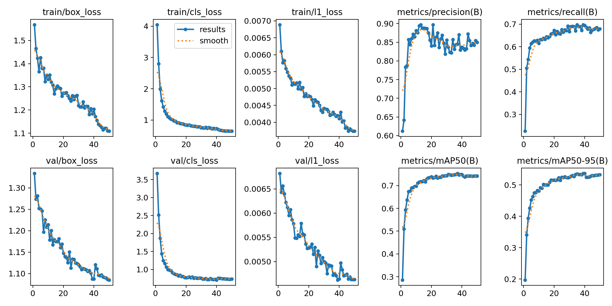
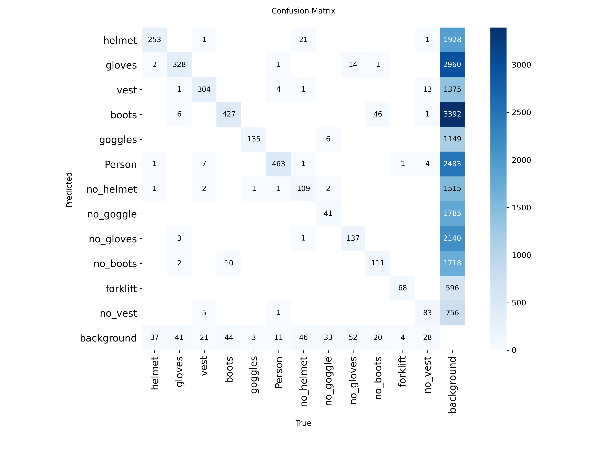
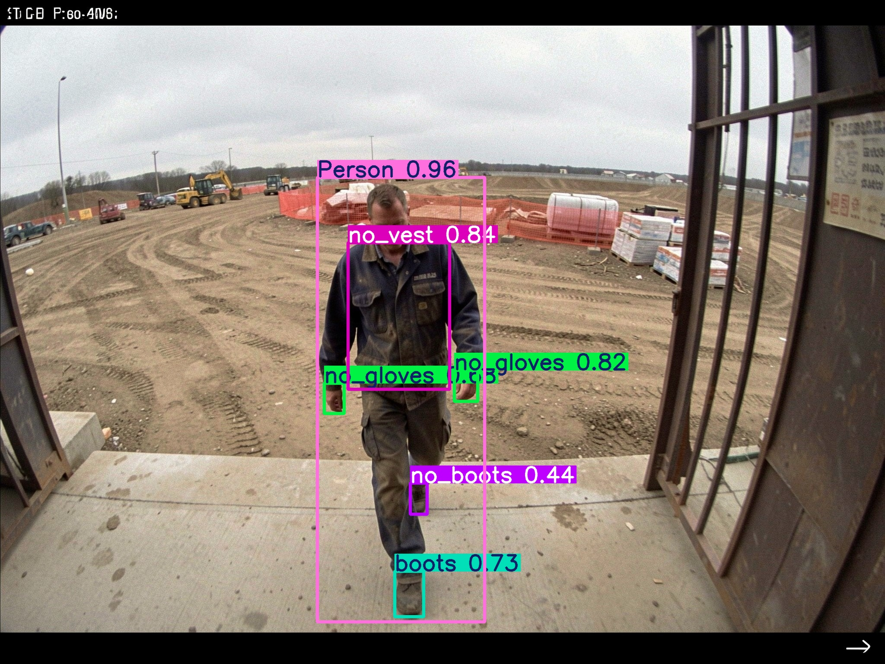
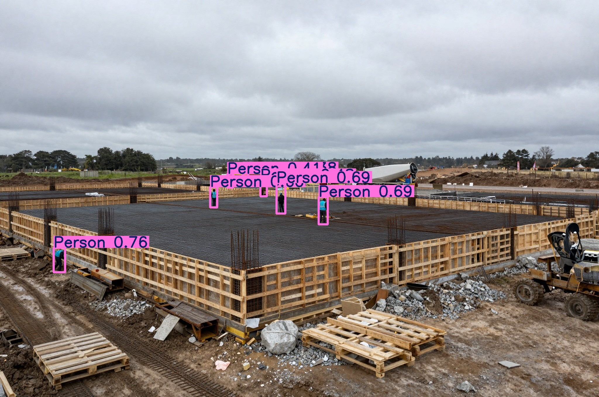
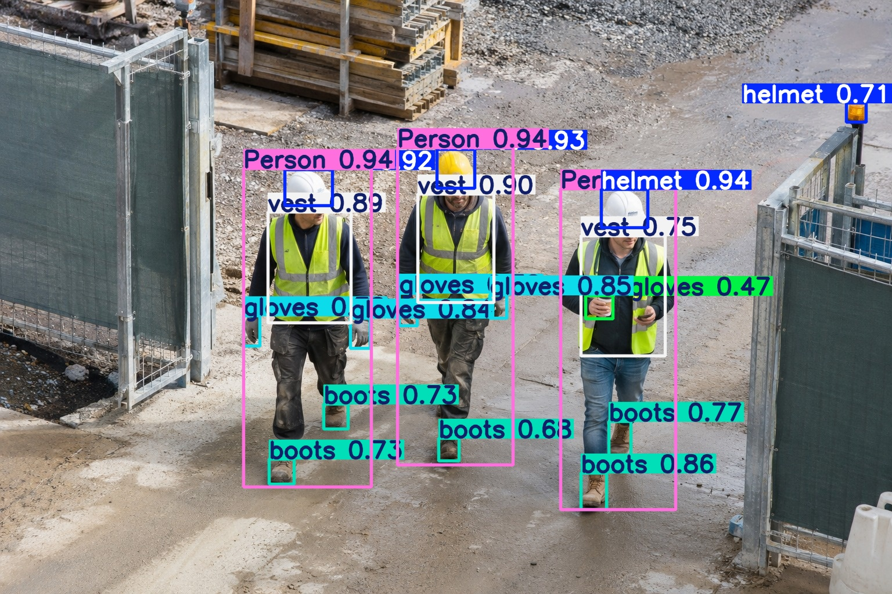

# Construction-site worker and PPE detection with YOLO

A small computer-vision project: I fine-tuned a pretrained **YOLO26n** object detector to find workers, personal protective equipment (PPE), missing PPE and forklifts in construction-site images. I then used the detections for a simple **worker–forklift proximity check**, a first step toward automated struck-by hazard monitoring.

I am a civil and structural engineer working on construction safety. I built this project to learn the deep-learning tools behind vision-based safety monitoring.

## What I did

1. **Data.** I used the public [Construction-PPE dataset](https://docs.ultralytics.com/datasets/detect/construction-ppe/) by Ultralytics (CC BY 4.0): 800 training and 200 validation images, 12 classes. The classes cover visible PPE (helmet, vest, gloves, boots, goggles), missing PPE (no_helmet, no_vest, no_gloves, no_boots, no_goggle), Person and forklift.
2. **Model.** I fine-tuned `yolo26n.pt` (2.4 M parameters, pretrained on COCO) for up to 50 epochs at 640 px. Early stopping had a patience of 15 epochs. Training ran on a Tesla T4 GPU in Kaggle Notebooks and took about 10 minutes.
3. **Evaluation.** I measured precision, recall and mAP for each class on the 200 validation images (2,961 labelled objects).
4. **Proximity check.** I flagged a worker when the centre of their bounding box came within 150 pixels of a forklift's box centre.

## Results

On the validation set, the model reached **mAP50 = 0.746** and **mAP50-95 = 0.534** overall. Inference took about 6 ms per image on the T4.

| Class | Precision | Recall | mAP50 | mAP50-95 |
| --- | --- | --- | --- | --- |
| Person | 0.948 | 0.898 | 0.947 | 0.785 |
| goggles | 0.885 | 0.935 | 0.947 | 0.615 |
| vest | 0.938 | 0.838 | 0.904 | 0.704 |
| helmet | 0.917 | 0.794 | 0.843 | 0.642 |
| forklift | 0.811 | 0.836 | 0.841 | 0.598 |
| gloves | 0.889 | 0.737 | 0.815 | 0.606 |
| boots | 0.807 | 0.694 | 0.780 | 0.578 |
| no_boots | 0.876 | 0.597 | 0.723 | 0.563 |
| no_vest | 0.893 | 0.643 | 0.700 | 0.481 |
| no_gloves | 0.867 | 0.542 | 0.635 | 0.393 |
| no_helmet | 0.899 | 0.536 | 0.626 | 0.383 |
| no_goggle | 0.462 | 0.147 | 0.196 | 0.058 |

*Precision is the share of predicted boxes that were correct. Recall is the share of real objects the model found. mAP50 is the overall detection quality, from 0 to 1.*

The proximity check flagged **2 of 12** sample validation images with a worker near a forklift. The closest case was 25 pixels apart.

### Training curves



### Confusion matrix



### Example detections





The full per-class results are in [`results/results_per_class.csv`](results/results_per_class.csv).

## What I learned

- **Workers are the easiest target.** Person had the best scores (mAP50 0.947, recall 0.898). For safety monitoring this matters most, because every other check depends on finding the worker first.
- **Detecting what is missing is harder than detecting what is there.** Every "missing PPE" class scored lower than its matching "visible PPE" class. For example, helmet scored 0.843 and no_helmet 0.626. A helmet has a clear shape and colour, while a bare head looks like many other things, so the model has to recognise an absence rather than an object.
- **The model is cautious about violations.** For missing PPE, precision stayed high (about 0.87–0.90) but recall was low (about 0.54–0.64). When the model reports a violation it is usually right, but it misses many real ones. In a safety system, a missed hazard is the more serious error, so recall deserves more attention than precision.
- **no_goggle almost failed (recall 0.147).** Eyes are tiny in most images, and this class has the fewest examples. Yet goggles themselves scored 0.947. The problem is the combination of a small object and an absence, not goggles in general. More examples and higher-resolution input would be the first things to try.
- **Pixels are not metres.** The proximity rule works on image distances, which depend on how far the camera is from the scene. Turning this into a real safety distance needs camera calibration or depth data. That is the central problem in crane and heavy-equipment struck-by monitoring.

## Limitations

- The dataset is small (1,000 images) and shows mostly ground-level views. It contains no top-down images like those from a crane-mounted camera or drone.
- Results come from a single training run without tuning, so other settings may do better.
- The proximity check is frame-by-frame, with no tracking or prediction of movement.

## Next steps

- Track workers across video frames with ByteTrack to estimate their movement and predict short-term paths.
- Test how well the model transfers to top-down drone or crane-camera images.
- Convert pixel distances to metres using a calibrated camera.
- Improve recall on the missing-PPE classes with more data, higher resolution or class-weighted training.

## How to run it

The notebook [`ppe_yolo_training.ipynb`](ppe_yolo_training.ipynb) runs top to bottom on any machine with a GPU, for example Kaggle Notebooks with GPU and internet turned on. The dataset downloads automatically.

```bash
pip install -r requirements.txt
```

## Credits

- Model and training framework: [Ultralytics YOLO](https://github.com/ultralytics/ultralytics) (AGPL-3.0)
- Dataset: Ultralytics Construction-PPE (CC BY 4.0)

This repository is released under AGPL-3.0, the same licence as Ultralytics.
